<br/>

### 🌌 Sobre mí

```yaml
usuario:    JVinrey
carrera:    Ingeniería de Software (7mo Semestre) 🎓
foco:       Frontend & Web Design 🎨
filosofía:  "Diseñar interfaces intuitivas potenciadas por el flujo moderno de IA"
stack_actual:
  frontend:      [Next.js, React, Tailwind CSS, TypeScript]
  backend_basics:[Node.js, PostgreSQL, Supabase, Prisma ORM]
  ai_workflow:   [Prompt Engineering, Claude, Kiro, Gemini]
```

- 🎯 **7mo Semestre** de Ingeniería de Software, profundizando con fuerza en **Frontend & UI/UX**.
- 🎨 Creando experiencias visuales modernas, limpias, intuitivas y 100% responsivas para celulares y PC.
- 🤖 **AI-Assisted Developer:** Gran dominio de prompting y herramientas de inteligencia artificial avanzadas (**Claude, Kiro, Gemini**) para acelerar el desarrollo y resolver problemas complejos.
- ⚙️ **Backend con fundamentos sólidos:** APIs en Next.js/Node, bases de datos relacionales (**PostgreSQL / Supabase**) y ORMs modernos (**Prisma**).

---

### 🚀 Tecnologías & Herramientas

#### 🎨 Frontend & Diseño (Mi Fuerte)

<p align="left">
  
  
  
  
  
  
  
  
</p>

#### 🤖 IA & Prompting Workflow

<p align="left">
  
  
  
  
</p>

#### 🗄️ Backend Básico & Bases de Datos

<p align="left">
  
  
  
  
  
  
</p>

#### 🛠️ Herramientas & Entorno

<p align="left">
  
  
  
  
  
</p>

---

### 📊 Actividad & Contribuciones

<div align="center">


<br/><br/>


<br/>


</div>

---

<div align="center">


</div>
