 

**Frontend Developer especializado en UI/UX e interfaces modernas**: React, Next.js, Tailwind CSS y TypeScript como stack principal. Integro IA (Claude, Kiro, Gemini) como copiloto de desarrollo para construir más rápido y con mayor calidad. 7mo semestre de Ingeniería de Software.

 

PROYECTOS

<table>
  <tr><td nowrap><code>01</code></td><td nowrap><b>Proyecto Rifa</b></td><td>Sistema de gestión de rifas con frontend moderno en Next.js, base de datos en Supabase y lógica en Prisma ORM.</td></tr>
  <tr><td nowrap><code>02</code></td><td nowrap><b>Portfolio</b></td><td>Sitio personal con diseño responsivo, animaciones CSS y optimizado para móvil y desktop.</td></tr>
</table>

<a href="https://github.com/JVinrey?tab=repositories">todos los repositorios →</a>

STACK

<table>
  <tr><td nowrap><b>Frontend</b></td><td>Next.js · React · Tailwind CSS · TypeScript · JavaScript · Vue.js · HTML5 · CSS3</td></tr>
  <tr><td nowrap><b>Backend</b></td><td>Node.js · PostgreSQL · MySQL · Supabase · Prisma ORM · Python</td></tr>
  <tr><td nowrap><b>IA & Workflow</b></td><td>Claude · Kiro · Gemini · Prompt Engineering avanzado</td></tr>
  <tr><td nowrap><b>Herramientas</b></td><td>Git · GitHub · VS Code · Docker · Linux</td></tr>
</table>

CONTACTO

[LinkedIn](https://www.linkedin.com/in/josue-vinces-reyes-07a85b339/) · [josuvince@gmail.com](mailto:josuvince@gmail.com)

 

